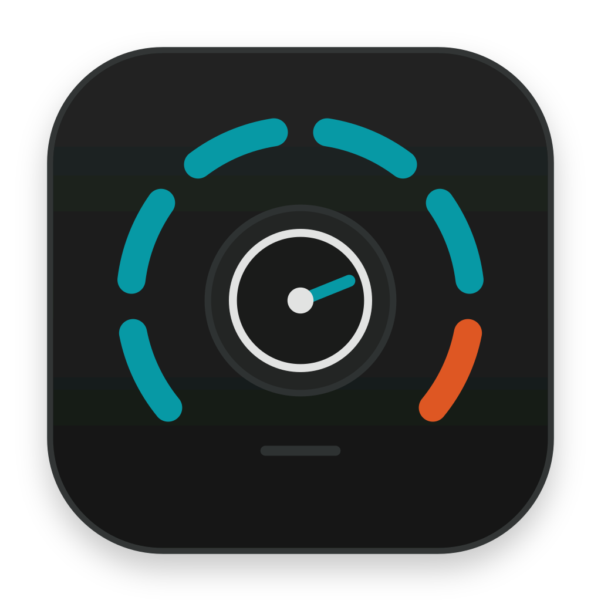
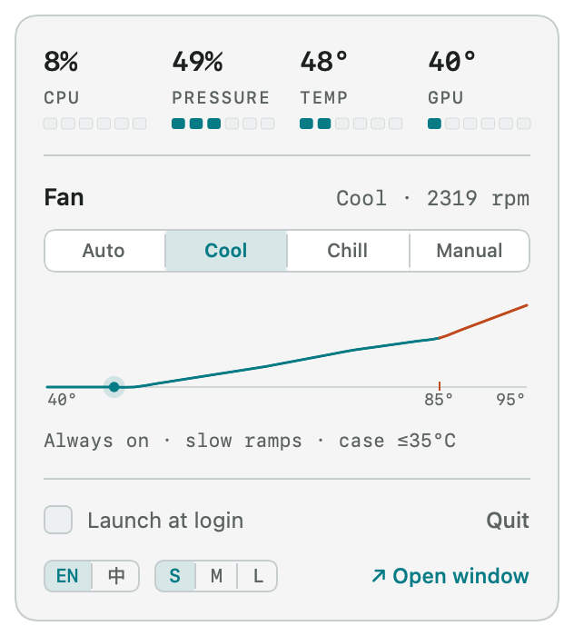
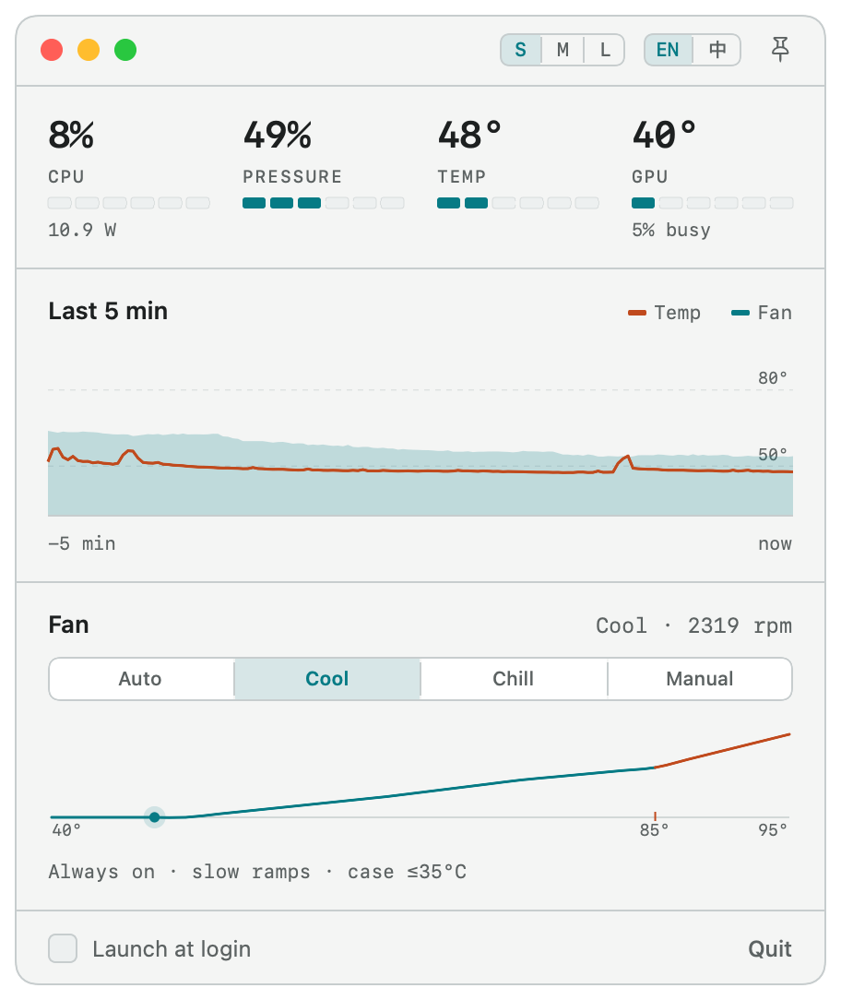

<p align="center">
  
</p>

<h1 align="center">CoolCurve</h1>

<p align="center">
  <b>Draw how your Mac's fan should behave.</b><br>
  Minimal thermal monitor &amp; fan curve control for Apple Silicon Macs.
</p>

<p align="center">
  <code>macOS 14+</code> · <code>Apple Silicon</code> · <code>Swift, no dependencies</code> · <code>MIT</code>
</p>

<p align="center"><b>English</b> · <a href="README.zh-CN.md">简体中文</a></p>

<p align="center">
  <picture>
    <source media="(prefers-color-scheme: dark)" srcset="docs/images/popover-en-dark.png">
    
  </picture>
  <picture>
    <source media="(prefers-color-scheme: dark)" srcset="docs/images/window-en-dark.png">
    
  </picture>
</p>

|  |  |  |  |
|:-:|:-:|:-:|:-:|
| **Auto**<br>macOS decides | **Cool**<br>quiet, keeps the case cool | **Chill**<br>cooler case, more fan noise | **Manual**<br>fixed speed |

<p align="center"><sub>Each mode is a curve from CPU temperature (40–95°C) to fan speed; the orange end is the high-temperature clamp both curve modes share.</sub></p>

A tiny native macOS menu bar app for two things: **seeing what your Mac is doing** (temperature, power, memory pressure, what's heating it up) and **deciding how its fan behaves**. No third-party dependencies. Requires macOS 14+ on Apple Silicon.

> [!WARNING]
> **Personal project, use at your own risk.**
> - Only tested on a **MacBook Pro 14" M3 (Mac15,3, single fan)**. Other models may use different SMC sensor names, so readings and fan behavior may be off.
> - The first time you enable fan control, it installs a **setuid-root helper** (`mm-smc-helper`) with administrator rights; from then on it can write to the SMC to change fan speed. Read the source before you use it.
> - Build it yourself from source. There's no signed or notarized download, no promise of maintenance, and no support.
>
> **Ran into a problem, or have a different Mac?** Instead of waiting for a fix, point an AI coding assistant (Claude Code or similar) at this repo and have it adapt the code for you. The project is small (~3k lines), dependency-free, and ships with the tooling to read your Mac's sensors.

---

## Features

- **Four fan modes**, each drawn in the app as its own curve (CPU temperature → fan speed) with a live dot showing where the fan is right now:
  - **Auto**: macOS manages the fan.
  - **Cool**: keep the case from warming up, quietly. On AC it's always in control and never stops the fan (hardware minimum). It follows interior heat (`TH0x`, which rises 1–2 minutes before the case does) and a slowly smoothed CPU average, and adds speed slowly if the palm rest or battery goes above `35°C`. Ramps up ≤1%/s, down ≤0.5%/s (holding 30 s after a rise). Quiet cap `60%`.
  - **Chill**: a cooler case in exchange for more fan noise. Always ≥`20%`, curves start ~5°C earlier, speeds up ahead of sustained CPU/GPU load, palm-rest target `33°C`. Ramps up ≤2%/s, down ≤0.5%/s (holding 60 s). Cap `80%`.
  - Cool and Chill share one high-temperature layer: when the CPU peak (including the `TCMz` hottest-core sensor, ~10 s smoothed) reaches `85°C` or macOS starts throttling, the cap goes away, a floor of 85°C→60% / 95°C→100% applies (following a ~40 s smoothed peak), and the fan ramps 4× faster. It only lets go below `80°C`, then holds for 60 s, so it doesn't swing around the threshold.
  - **Manual**: pick a fixed speed with the slider.
  - Percentages are positions between minimum and maximum RPM (0% = minimum RPM, still spinning).
- **Safety nets**:
  - CPU peak (including `TCMz`) at or above `95°C` for ~6 s: Manual hands the fan back to macOS; Cool/Chill stay selected but pause, and resume below `85°C`.
  - On battery: Manual hands back to macOS when you unplug; Cool/Chill pause while on battery (you can still select them) and resume when you plug in.
  - Quitting or killing the app hands the fan back to macOS. Fanless Macs (e.g. MacBook Air) get monitoring only.
- **Glanceable first, details on demand**:
  - Menu bar readout in **S / M / L** widths (notch-friendly, fixed width so it never jitters).
  - Click for a popover; right-click or `↗` for a pinnable window with **5-minute temperature / fan / throttling history**, **GPU busy %** and **whole-system power (W)**.
  - **Heat source**: hidden while the Mac is idle; when it's working, shows the busiest process, expandable to the top 3 with switch to / quit / force quit.
- **Light**: samples every 2 s and only does the expensive work when it matters (no process scan while idle, SMC key lookups cached, HID sensors read only as a fallback). About 1–2% of one core with the window open.
- **Native and bilingual**: Swift + SwiftUI + AppKit + IOKit (AppleSMC) + Mach/libproc, English/Chinese, light/dark `maxminimalism` theme.

---

## Why not design your own fan curve?

How a fan should behave is personal. One person wants silence and doesn't mind a warm palm rest; another wants the case cool on their lap; another only cares about the chip never throttling. It also depends on your Mac, your desk, your room, and your ears. No preset fits everyone, including the ones in this repo.

Now that an AI coding assistant can read, change, and test code for you, you don't have to settle for someone else's presets. **This project is an invitation: design the curve and the modes you actually want.**

That's how CoolCurve's own modes came about. We read every temperature sensor on the test Mac, ran full-load tests while logging them, found which sensors track the chip, the interior, and the case, and shaped the Cool and Chill curves from that data. You can do the same:

1. **Look at your sensors**: build the app, then run `./CoolCurve.app/Contents/MacOS/mm-smc-helper status`. Ask your assistant to dump every temperature key on your Mac and work out which ones matter.
2. **Say what you care about**: quiet, a cool palm rest, a cool lap, no throttling, battery life… in plain words.
3. **Measure**: have the assistant run a load test (for example 10 minutes of full CPU load) while logging fan speed and temperatures, then compare.
4. **Shape it**: each mode is a `ChassisFanProfile` in [`FanCurveControllers.swift`](Sources/CoolCurve/Services/FanCurveControllers.swift): the curve points, the floor, the quiet cap, how fast it ramps up and down. Change them, add a profile of your own, or write a new controller.
5. **Watch it**: the chart in the app is drawn from those same profiles, and the live dot shows the fan following (or not following) your curve.

A prompt to start with:

> This is CoolCurve, a fan control app for Apple Silicon Macs. My Mac is a *[model]*. I want *[what you care about]*. Read the code, list the temperature sensors on my Mac, run a 10-minute load test logging fan speed and temperatures, and propose a new fan mode for me. Keep the shared high-temperature layer and the 95°C safety fallback.

Whatever you change, keep the safety nets: the shared high-temperature layer, the 95°C fallback, and handing the fan back to macOS on quit.

---

## Build and run

```bash
zsh scripts/build_app.sh
open CoolCurve.app
```

The first time you enable fan control, click "Unlock fan control" and enter your administrator password once. The app installs `mm-smc-helper` into `/Library/PrivilegedHelperTools/` (setuid root), and all SMC writes go through it from then on.

Check sensors and fans from the command line:

```bash
./CoolCurve.app/Contents/MacOS/mm-smc-helper status
```

Regenerate the README images (popover and window in English/Chinese, light/dark, plus the mode curves) from live readings. It never touches the fan or your settings; the number is how many seconds of history to collect first:

```bash
./CoolCurve.app/Contents/MacOS/CoolCurve --snapshot docs/images 300
```

## Package a DMG (for your own machines)

```bash
zsh scripts/package_dmg.sh 1.0.0
```

The output lands in `dist/CoolCurve-1.0.0-arm64.dmg` with its SHA-256 printed. Without Apple Developer signing and notarization, macOS will refuse to open it on another Mac until you run:

```bash
xattr -cr /Applications/CoolCurve.app
```

---

## Project layout

```text
docs/images/                 README screenshots and mode curves (generated)
Resources/
├── AppIcon.icns             App icon (segmented gauge knob)
├── AppIcon.svg              App icon source
└── MenuBarIcon.svg          Menu bar icon source
Sources/
├── CSMCKit/                 C: AppleSMC read/write + IOHID temperature sensors
├── SMCKit/                  Swift: SMCClient — thermal snapshot, power, fan control
├── mm-smc-helper/           Root helper CLI: status / auto / set / ratio
└── CoolCurve/               Menu bar app and main window
    ├── main.swift           Status item, popover and window lifecycle
    ├── AppState.swift       Sampling loop, fan modes, safety nets, preferences
    ├── L10n.swift           English/Chinese strings
    ├── Snapshot.swift       `--snapshot`: renders the README images
    ├── Services/            FanCurveControllers (Cool/Chill profiles), FanControlService,
    │                        SystemMonitorService, ProcessSampler
    └── Views/               MenuBarPopoverView, MainWindowView, Components,
                             FanCurveChart, MmDesignSystem
scripts/
├── build_app.sh             Native build that produces CoolCurve.app
├── generate_icon.swift      Generates the full-size AppIcon.icns
└── package_dmg.sh           Packages a DMG
```

> The build script calls the Command Line Tools `swiftc` directly, without the SwiftUI macro plugins, so views don't use `@State`; all UI state lives in `AppState`.

---

## License

[MIT](LICENSE): free to use, modify, and distribute, provided as is, without warranty.
