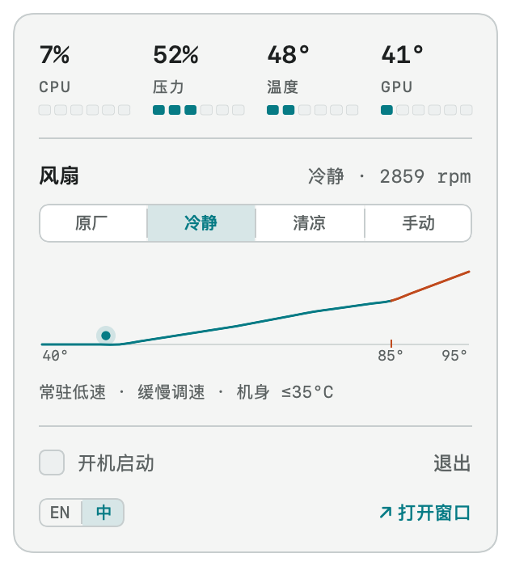
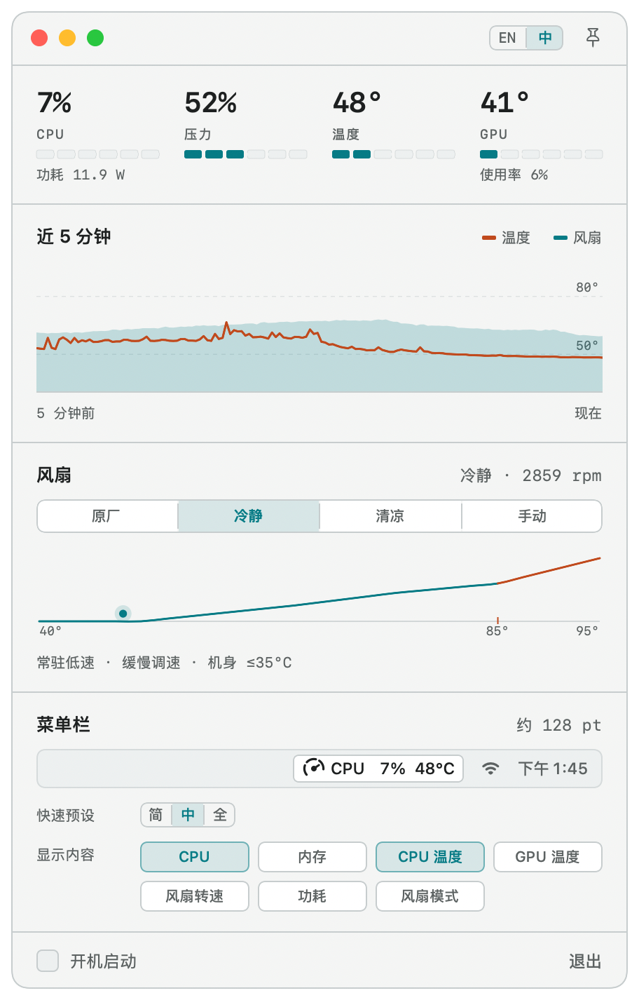

<p align="center">
  
</p>

<h1 align="center">CoolCurve</h1>

<p align="center">
  <b>画出你想要的风扇曲线。</b><br>
  Apple Silicon Mac 的极简温控与风扇曲线工具。
</p>

<p align="center">
  <code>macOS 14+</code> · <code>Apple Silicon</code> · <code>Swift · 零依赖</code> · <code>MIT</code>
</p>

<p align="center"><a href="README.md">English</a> · <b>简体中文</b></p>

<p align="center">
  <picture>
    <source media="(prefers-color-scheme: dark)" srcset="docs/images/popover-zh-dark.png">
    
  </picture>
  <picture>
    <source media="(prefers-color-scheme: dark)" srcset="docs/images/window-zh-dark.png">
    
  </picture>
</p>

|  |  |  |  |
|:-:|:-:|:-:|:-:|
| **原厂**<br>交给 macOS | **冷静**<br>安静，机身不热 | **清凉**<br>机身更凉，风声更大 | **手动**<br>固定转速 |

<p align="center"><sub>每个模式都是一条从 CPU 温度（40–95°C）到风扇转速的曲线，橙色的末段是两个曲线模式共用的高温压制。</sub></p>

一个极简的原生 macOS 菜单栏工具，只做两件事：**看清 Mac 在干什么**（温度、功耗、内存压力、谁在发热），以及**决定风扇怎么转**。零第三方依赖，要求 macOS 14+、Apple Silicon。

> [!WARNING]
> **个人项目，风险自负。**
> - 只在 **MacBook Pro 14" M3（Mac15,3，单风扇）** 上测试过。其他机型的 SMC 传感器名可能不同，温度读数和风扇策略可能不准确。
> - 首次开启风扇控制时会以管理员权限安装一个 **setuid root 的辅助程序**（`mm-smc-helper`），之后它可以直接写 SMC 改风扇转速。使用前请先阅读源码。
> - 需要自行从源码编译；不提供签名或公证过的安装包，不保证维护，也不提供支持。
>
> **遇到问题，或者你的 Mac 不是同一款？** 与其等别人修，不如直接让你的 AI 编程助手（Claude Code 等）接入这个仓库帮你改。项目很小（约 3 千行）、零依赖，读取本机传感器的工具也都在仓库里。

---

## 核心特性

- **4 档风扇策略**，每一档在 App 里都画成自己的曲线（CPU 温度 → 风扇转速），并用一个实时圆点显示风扇此刻的位置：
  - **原厂（Auto）**：完全交由 macOS 原生温控自动调节。
  - **冷静（Cool）**：机身不热、声音优先。插电时常驻接管、不停转（最低转速）；主要跟随机内热量（`TH0x`，比机身早 1–2 分钟升温）和慢速平滑的 CPU 平均温度，掌托/电池超过 `35°C` 时缓慢追加转速；升速 ≤1%/秒、降速 ≤0.5%/秒（升速后保持 30 秒）；静音上限 `60%`。
  - **清凉（Chill）**：机身更凉、允许更多风噪。常驻 ≥`20%` 转速；曲线比冷静提前约 5°C；CPU/GPU 负载持续偏高时提前提速；掌托/电池目标 `33°C`；升速 ≤2%/秒、降速 ≤0.5%/秒（升速后保持 60 秒）；上限 `80%`。
  - 冷静和清凉共用高温压制：CPU 峰值（含最热核心汇总传感器 `TCMz`，约 10 秒平滑）≥ `85°C` 或系统开始降频时，取消上限、按 85°C→60% / 95°C→100% 兜底（跟随约 40 秒平滑的峰值），并以 4 倍速升速；降到 `80°C` 以下才退出，退出后先保持 60 秒再降，避免在门槛附近来回摆。
  - **手动（Manual）**：拖动滑块固定转速。
  - 百分比指最低转速到最高转速之间的位置（0% = 最低转速，不会停转）。
- **多重安全兜底**：
  - CPU 峰值（含 `TCMz`）连续约 6 秒 ≥ `95°C`：手动档交还 macOS 原生温控；冷静/清凉保持所选模式但暂停，降到 `85°C` 以下自动恢复。
  - 电池供电：手动档在拔电时交还系统；冷静/清凉在电池下暂停（可照常选择），接上电源自动恢复。
  - 退出或终止 App 时交还 macOS 原生温控；无风扇机型（如 MacBook Air）自动切换为纯监控模式。
- **渐进式信息展示**：
  - 菜单栏读数自由组合：CPU、内存、CPU/GPU 温度、风扇转速、功耗、风扇模式任意勾选，保留 简 / 中 / 全 快速预设，主窗口里实时预览；宽度固定零抖动，太宽时提示刘海屏可能挡住。
  - 左键弹窗快速查看与调节；右键或点 `↗` 打开可置顶主窗口，含 **近 5 分钟温度/风扇/降频曲线**、**GPU 使用率**与 **整机实时功耗（W）**。
  - **可交互发热源**：机器空闲时自动隐藏，发热时显示头号高耗进程，点击展开 Top 3，支持一键切换、退出或强退。
- **轻量**：每 2 秒采样一次，只在需要时做耗时的事（闲置时不扫描进程、缓存 SMC 传感器信息、HID 传感器只作后备）。主窗口开着时约占单核 1–2%。
- **原生与双语**：Swift + SwiftUI + AppKit + IOKit（AppleSMC）+ Mach/libproc，内置中/英切换与深/浅色 `maxminimalism` 主题。

---

## 为什么不自己设计你需要的风扇曲线？

风扇该怎么转，是很个人的事。有人只要安静，不在乎掌托温热；有人把电脑放在腿上，想要机身凉；有人只在乎芯片别降频。它还取决于你的机型、桌面、房间和耳朵。没有哪组预设适合所有人，包括这个仓库里的。

现在 AI 编程助手已经能替你读代码、改代码、跑测试，你不必再将就别人定好的预设。**这个项目想发出一个倡议：设计你自己真正想要的曲线和模式。**

CoolCurve 自己的模式就是这么来的：我们读出测试机上全部的温度传感器，一边满载一边记录，找出哪些传感器代表芯片、哪些代表机内、哪些代表机身，再根据这些数据定出冷静和清凉两条曲线。你也可以这样做：

1. **看清你的传感器**：编译后运行 `./CoolCurve.app/Contents/MacOS/mm-smc-helper status`，再让 AI 把你这台 Mac 上所有温度传感器都读出来，判断哪些有用。
2. **说清你在乎什么**：安静、掌托凉、放腿上不烫、不降频、续航……用大白话说就行。
3. **实测**：让 AI 跑一段负载测试（比如满载 10 分钟），同时记录风扇转速和各处温度，然后对比。
4. **调曲线**：每个模式都是 [`FanCurveControllers.swift`](Sources/CoolCurve/Services/FanCurveControllers.swift) 里的一个 `ChassisFanProfile`：曲线上的点、最低转速、静音上限、升降速快慢。改这些参数、加一个你自己的模式，或者干脆写一个新的控制器。
5. **看效果**：App 里的曲线图就是用这些参数画的，实时圆点会告诉你风扇有没有照着你的曲线走。

可以从这样一段话开始：

> 这是 CoolCurve，一个 Apple Silicon Mac 的风扇控制 App。我的电脑是 *[机型]*，我想要 *[你在乎的事]*。请先读代码，列出我这台 Mac 上的温度传感器，跑一个 10 分钟的负载测试并记录风扇转速和温度，然后为我设计一个新的风扇模式。保留两个模式共用的高温压制和 95°C 安全兜底。

不管怎么改，请保留安全兜底：共用的高温压制、95°C 兜底，以及退出时把风扇交还 macOS。

---

## 构建与运行

```bash
zsh scripts/build_app.sh
open CoolCurve.app
```

首次开启风扇控制时，点击「解锁风扇控制」输入一次管理员密码。App 会将 `mm-smc-helper` 安装到 `/Library/PrivilegedHelperTools/`（setuid root），之后所有 SMC 写入均通过该辅助工具完成。

命令行查看传感器与风扇状态：

```bash
./CoolCurve.app/Contents/MacOS/mm-smc-helper status
```

用实时读数重新生成 README 里的图片（中/英、深/浅色的弹窗和主窗口，以及模式曲线）。不会碰风扇，也不会改你的设置；最后的数字是先收集多少秒的历史数据：

```bash
./CoolCurve.app/Contents/MacOS/CoolCurve --snapshot docs/images 300
```

## 打包 DMG（给自己的电脑用）

```bash
zsh scripts/package_dmg.sh 1.0.0
```

产物会输出到 `dist/CoolCurve-1.0.0-arm64.dmg`，并打印 SHA-256 校验值。没有 Apple 开发者签名和公证时，在另一台 Mac 上首次打开会被系统拦下，需要先执行：

```bash
xattr -cr /Applications/CoolCurve.app
```

---

## 目录结构

```text
docs/images/                 README 截图与模式曲线（自动生成）
Resources/
├── AppIcon.icns             应用图标（分段仪表旋钮）
├── AppIcon.svg              应用图标矢量源文件
└── MenuBarIcon.svg          菜单栏图标矢量源文件
Sources/
├── CSMCKit/                 C：AppleSMC 读写 + IOHID 温度传感器
├── SMCKit/                  Swift：SMCClient，温度快照、功耗与风扇控制
├── mm-smc-helper/           root 辅助命令行：status / auto / set / ratio
└── CoolCurve/               菜单栏与主窗口 App
    ├── main.swift           状态栏图标、弹窗与主窗口生命周期
    ├── MenuBarReadout.swift 菜单栏显示项、文字格式与固定宽度
    ├── AppState.swift       采样循环、风扇策略、安全兜底、偏好持久化
    ├── L10n.swift           中/英文案表
    ├── Snapshot.swift       `--snapshot`：生成 README 图片
    ├── Services/            FanCurveControllers（冷静/清凉参数）、FanControlService、
    │                        SystemMonitorService、ProcessSampler
    └── Views/               MenuBarPopoverView、MainWindowView、Components、
                             FanCurveChart、MenuBarSettingsSection、MmDesignSystem
scripts/
├── build_app.sh             原生编译并生成 CoolCurve.app
├── generate_icon.swift      生成全尺寸 AppIcon.icns
└── package_dmg.sh           一键打包 DMG
```

> 构建脚本直接调用 Command Line Tools 的 `swiftc`，无 SwiftUI 宏插件依赖，因此视图内不使用 `@State`，界面状态统一由 `AppState` 管理。

---

## 许可证

[MIT](LICENSE)：可自由使用、修改和分发，按原样提供，不附带任何担保。
